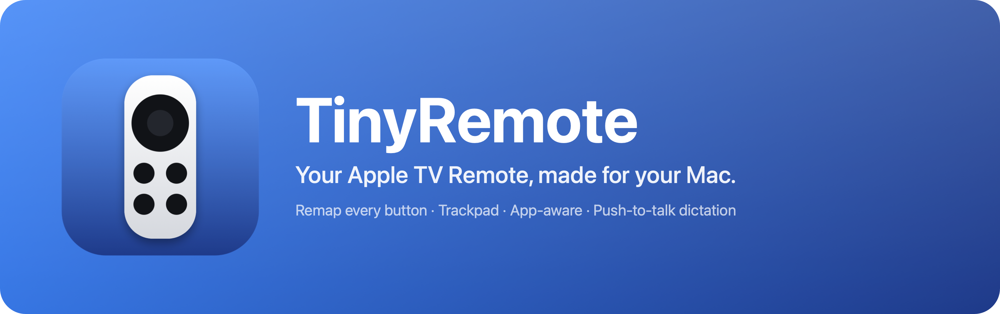
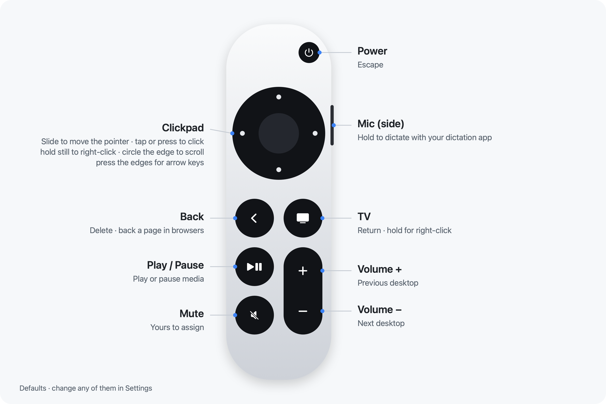
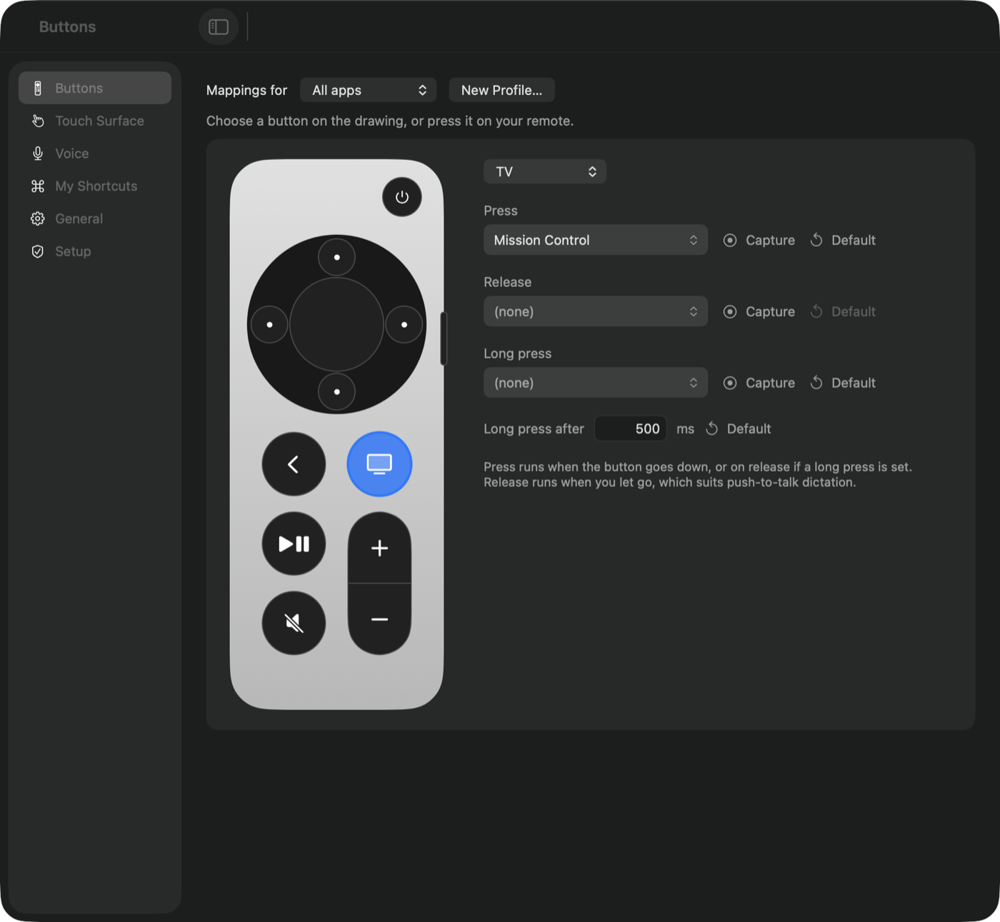
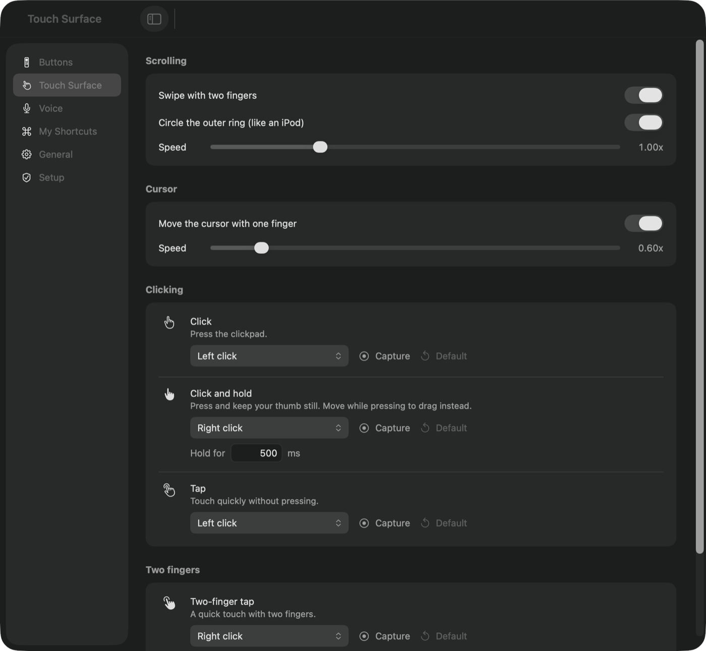
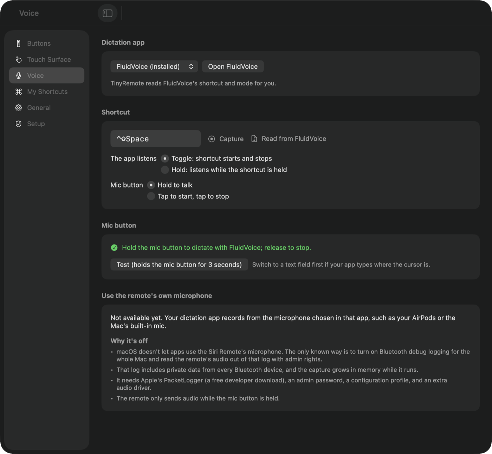
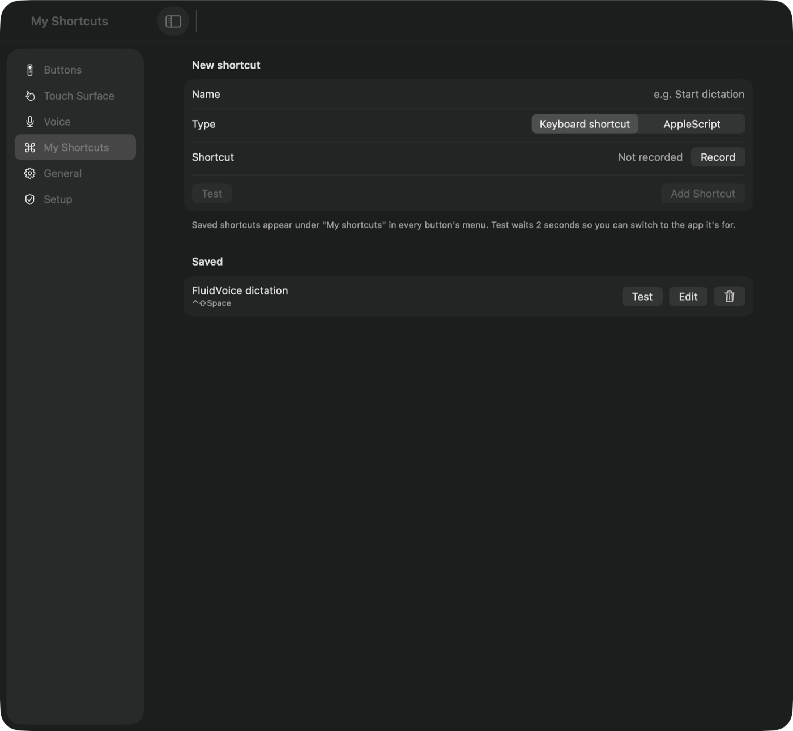
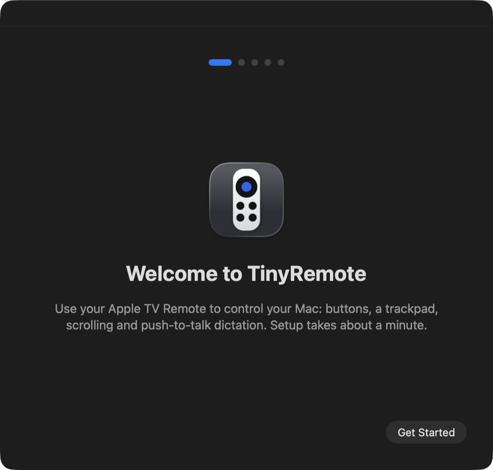
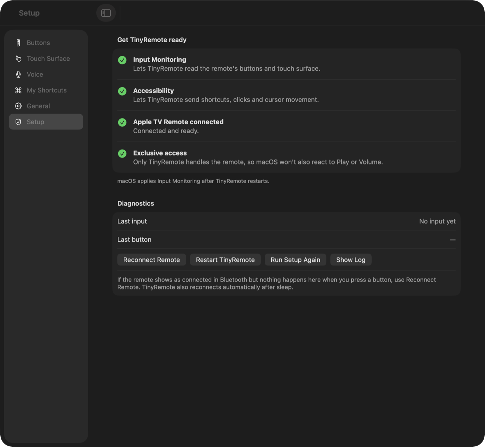

<p align="center">
  <picture>
    <source media="(prefers-color-scheme: dark)" srcset="docs/banner-dark.png">
    
  </picture>
</p>

<p align="center">
  <a href="https://github.com/foleykyle01/TinyRemote/releases/latest"></a>
  
  
  
  
  <a href="LICENSE"></a>
</p>

<p align="center">
  <a href="https://github.com/foleykyle01/TinyRemote/releases/latest/download/TinyRemote.zip"><b>Download</b></a>
  &nbsp;·&nbsp; <a href="#install">Install</a>
  &nbsp;·&nbsp; <a href="#your-thumb-does-everything">How it works</a>
  &nbsp;·&nbsp; <a href="#make-it-yours">Make it yours</a>
  &nbsp;·&nbsp; <a href="#faq">FAQ</a>
  &nbsp;·&nbsp; <a href="CHANGELOG.md">Changelog</a>
</p>

The Apple TV Remote is a lovely little controller: a clickpad, a touch surface and a handful of buttons, all on Bluetooth. Paired with a Mac, it mostly sits in a drawer.

**TinyRemote turns it into a couch-friendly Mac controller.** You can move the pointer, click, scroll, switch desktops, go back a page and start dictation, and you can remap every button to whatever you like. It's a single 3 MB menu-bar app with no AI assistant, background services or admin helpers.

## Your thumb does everything

| Do this | And TinyRemote… |
|---|---|
| Slide on the clickpad | Moves the pointer |
| Tap, or press the clickpad | Clicks |
| Press and hold still | Right-clicks |
| Press and slide | Drags |
| Circle the outer ring, or swipe with two fingers | Scrolls |
| Press **Back** in Safari or Chrome | Goes back a page (long press goes forward) |
| Hold the **mic** button | Dictates with FluidVoice, Wispr Flow, superwhisper or any other dictation app |
| Press **Volume + / −** | Switches desktops |

Every one of these is a default you can change.

<p align="center">
  <picture>
    <source media="(prefers-color-scheme: dark)" srcset="docs/remote-map-dark.png">
    
  </picture>
</p>

## Features

<table>
  <tr>
    <td width="50%" valign="top">
      <h3>Remap every button</h3>
      Press, release and long press for each button, each with its own hold time. Pick a preset, capture any shortcut (even reserved ones like ⌃→ and ⌘Space), or run an AppleScript.
    </td>
    <td width="50%" valign="top">
      <h3>App-aware</h3>
      Profiles change buttons per app. A built-in browser profile makes Back go back a page, but it stays Delete while you're typing in a text field. Create profiles for any app.
    </td>
  </tr>
  <tr>
    <td valign="top">
      <h3>A real trackpad</h3>
      Tap to click, hold to right-click, press and slide to drag, and two-finger tap and click. Clicks behave exactly like a real mouse, so double-clicks and selection work in every app.
    </td>
    <td valign="top">
      <h3>Push-to-talk dictation</h3>
      Choose your dictation app and TinyRemote sets up the mic button. It reads FluidVoice's shortcut for you, and supports hold-to-talk or tap-to-toggle.
    </td>
  </tr>
  <tr>
    <td valign="top">
      <h3>My Shortcuts</h3>
      Record, name and test your own shortcuts and AppleScripts once, then put them on any button or gesture.
    </td>
    <td valign="top">
      <h3>Recovers on its own</h3>
      Reconnects after sleep, takes the remote back if another app grabs it, and warns you in the menu bar if a permission goes missing.
    </td>
  </tr>
</table>

## Make it yours

TinyRemote is deliberately small. It does the remote well and leaves the rest to you. That's why it's open source: the idea is that you build the integrations you need instead of waiting for someone else to.

**Without writing code**

- **My Shortcuts** can be a keyboard shortcut or an AppleScript, and AppleScript reaches a long way:
  ```applescript
  tell application "Music" to playpause                                  -- control any scriptable app
  do shell script "open -g 'shortcuts://run-shortcut?name=Movie%20Mode'"  -- run a Shortcuts automation
  do shell script "curl -s -X POST http://homebridge.local:8581/scene/tv" -- hit a webhook or smart-home API
  ```
  Put any of these on a button, a long press or a gesture.
- **App profiles** give buttons a different job in a specific app, like Back going back a page in browsers.

**With a few lines of Swift**

| To add | Edit |
|---|---|
| A new built-in action (shows up in every action menu) | `Actions.named` and the `switch` in `Actions.perform`, in `Sources/Actions.swift` |
| A dictation app preset | `DictationApp.all` in `Sources/Voice.swift` |
| A built-in app profile, like the browser one | `Config.defaultProfiles` in `Sources/Config.swift` |
| A new gesture | `Gesture` in `Sources/Config.swift`, and its detection in `Remote.touch` in `Sources/Remote.swift` |

Build with `./build.sh` and check with `--self-test` (see [Development](#development)). If your integration could help others, open a pull request.

## Tiny by design

| | |
|---|---|
| App size | **3.2 MB** |
| Memory | **~60 MB** |
| CPU when idle | **0%** |
| Dependencies | **None.** Plain Swift and Apple frameworks, about 2,400 lines |
| Runs as admin | **Never** |
| Network | Checks this repo for updates (can be turned off). No analytics. |

## Screenshots

<table>
  <tr>
    <td><br><sub><b>Buttons</b>: a drawn remote with per-button and per-app mappings</sub></td>
    <td><br><sub><b>Touch Surface</b>: scrolling, cursor, clicking and gestures</sub></td>
  </tr>
  <tr>
    <td><br><sub><b>Voice</b>: push-to-talk for your dictation app</sub></td>
    <td><br><sub><b>My Shortcuts</b>: record, name and test your own</sub></td>
  </tr>
  <tr>
    <td><br><sub><b>Welcome</b>: a one-minute first-run guide</sub></td>
    <td><br><sub><b>Setup</b>: permissions and live diagnostics</sub></td>
  </tr>
</table>

## Install

**Requirements:** a Mac with Apple silicon running macOS 15 or later, and an aluminum Apple TV Remote (2nd or 3rd generation).

### One command

```sh
curl -fsSL https://github.com/foleykyle01/TinyRemote/releases/latest/download/install.sh | bash
```

This installs TinyRemote into `~/Applications`, replaces any older copy and opens it.

### Manual download

1. Download [TinyRemote.zip](https://github.com/foleykyle01/TinyRemote/releases/latest/download/TinyRemote.zip), unzip it and move **TinyRemote.app** to Applications.
2. TinyRemote isn't notarized, so macOS blocks it the first time when it comes from a browser. Allow it with
   `xattr -dr com.apple.quarantine /Applications/TinyRemote.app`, or open it and click **Open Anyway** in **System Settings → Privacy & Security**.

### First launch

A short welcome guide walks you through:

1. **Allowing access:** Input Monitoring (to read the remote) and Accessibility (to send shortcuts, clicks and cursor movement).
2. **Connecting your remote:** hold **Back** and **Volume +** near the Mac for 5 seconds, then pick it in Bluetooth settings.
3. **Trying it out:** press buttons and use the clickpad to see it working.

TinyRemote then lives in the menu bar and opens at login. You can change both in **General**, and rerun the guide from **Setup**.

### Updates

TinyRemote checks for new releases on launch and every few hours, then installs them and restarts itself. Toggle this or click **Check Now** in **General**.

## FAQ

<details>
<summary><b>Do I need to point the remote at my Mac?</b></summary>

No. The Apple TV Remote talks to your Mac over Bluetooth, so it works from anywhere in the room, pointed anywhere. Macs don't have IR receivers anymore. The remote's IR emitter is only for TVs and soundbars.
</details>

<details>
<summary><b>Can the remote be used as a microphone?</b></summary>

Not by TinyRemote. macOS doesn't let apps use the Apple TV Remote's microphone. The only known way is to turn on Bluetooth debug logging for the whole Mac and read the audio out of that log with admin rights. That log includes private data from every Bluetooth device, and the capture keeps growing in memory. Instead, the mic button triggers your dictation app, which listens through your Mac's microphone or AirPods.
</details>

<details>
<summary><b>Which remotes work?</b></summary>

The aluminum Apple TV Remote (2nd and 3rd generation, Lightning or USB-C). The older black-glass Apple TV Remote (2015) and the white Apple Remote aren't supported.
</details>

<details>
<summary><b>Can I point the remote at the screen to move the pointer?</b></summary>

No. The aluminum Apple TV Remote has no motion sensors, so the clickpad's touch surface moves the pointer instead.
</details>

<details>
<summary><b>Does it work alongside other remote apps?</b></summary>

TinyRemote takes exclusive access to the remote, so macOS and other apps don't also react to your presses. If another app is holding the remote, the menu-bar icon shows a warning and TinyRemote takes over once that app quits.
</details>

<details>
<summary><b>Why isn't it notarized?</b></summary>

Notarization needs a paid Apple Developer ID. The one-command install and the built-in updater download without the quarantine flag, so macOS doesn't block them. Every line of source is in this repo if you'd like to build it yourself.
</details>

## Uninstall

Quit TinyRemote from its menu-bar icon, delete `TinyRemote.app`, and remove it from **System Settings → General → Login Items** if it's still listed. Its settings live in `~/Library/Application Support/TinyRemote`.

## Development

No Xcode project and no dependencies, just `swiftc`.

```sh
./build.sh                              # build into ~/Applications/TinyRemote.app
~/Applications/TinyRemote.app/Contents/MacOS/TinyRemote --self-test
~/Applications/TinyRemote.app/Contents/MacOS/TinyRemote --snapshot /tmp/shots   # render every settings page to PNG
swift tools/make-icon.swift             # app icon (Resources/AppIcon.icon) and README logos; needs Xcode
swift tools/make-readme-art.swift       # README banner, remote map and social preview (docs/social-preview.jpg)
./release.sh 0.7.0 "- What changed"     # maintainers: bump, build, tag, publish and add to CHANGELOG.md
```

- **`Sources/Remote.swift`:** reads the remote. Buttons come through IOKit HID with exclusive access; the touch surface comes through Apple's private MultitouchSupport framework.
- **`Sources/Actions.swift`:** turns actions into keyboard, mouse and media events.
- **`Sources/SettingsView.swift`, `Voice.swift`, `Profiles.swift`, `Onboarding.swift`:** the SwiftUI interface.
- **Signing:** builds are signed with the maintainer's certificate when it's available, and ad hoc otherwise. Set `SIGN_IDENTITY` to use your own. Keep it the same between builds, or macOS asks for permissions again.

Issues and pull requests are welcome.

## License

[MIT](LICENSE). TinyRemote isn't affiliated with Apple. Apple TV is a trademark of Apple Inc.
